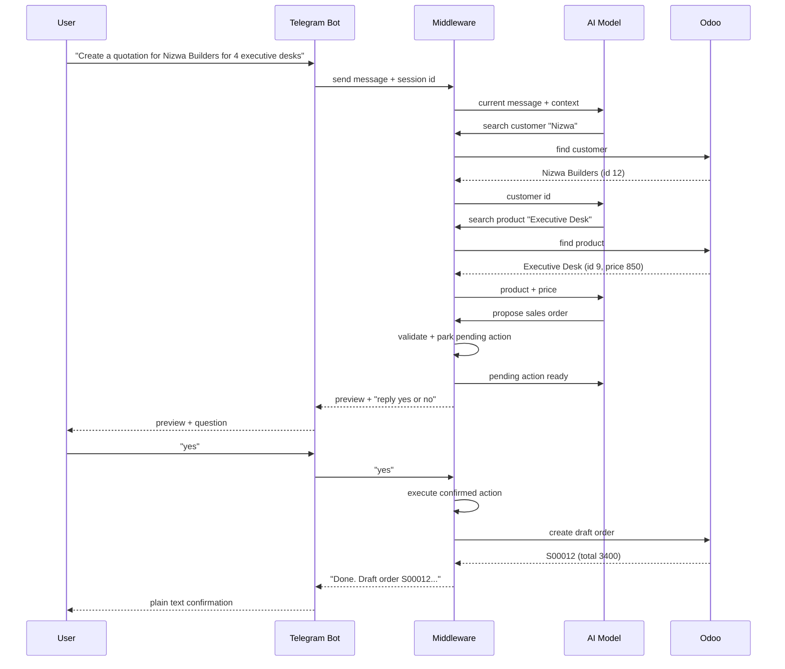
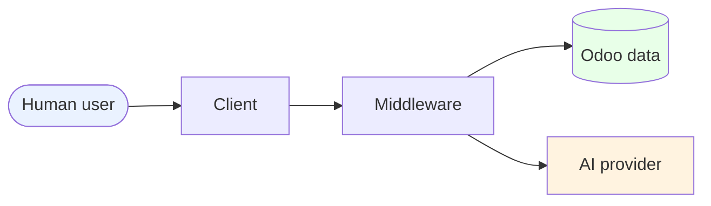

# AI-Assisted Activity Tracker and Controller

## Non-Technical Summary & Visual Overview

Version discussed in this document: current `development` branch
Repository: `ai-assisted-activity-tracker-and-controller`

---

## 1. What is this project?

This project is a **chat assistant for a sales team that uses Odoo**. Instead of opening Odoo in a browser and clicking through forms, a salesperson simply chats with a Telegram bot (by typing or sending a voice note). The bot understands plain language and performs CRM, sales, and calendar tasks in Odoo.

In simple terms:

> **Telegram becomes the remote control for your Odoo CRM, Sales, and Calendar.**

The assistant is built as a **separate “middleware” service** (a smart go-between). Odoo remains the system of record, and nothing is written there until the user confirms with **“yes”**.

---

## 2. Who is it for?

- **Sales representatives / account managers** who want to log calls, create quotations, check orders, and book meetings while away from their desk.
- **Managers** who want a searchable, auditable trail of every AI-assisted action.
- **Administrators** who want to control who can use the assistant and who can confirm orders.

Supported input:

- Text chat in Telegram
- Voice notes (multiple languages supported; Bengali and English highlighted in the project docs)

Supported output:

- Plain-text replies in Telegram
- Optional REST API for other systems/clients

---

## 3. What can it do?

### Daily sales operations

| Area | Example request | Result |
|---|---|---|
| **Create quotation** | “Create a quotation for Nizwa Builders for 4 executive desks and 4 ergonomic chairs.” | Draft sales order created in Odoo with Odoo’s own prices |
| **Sell a product that does not exist yet** | “Sell 2 Glass Whiteboard at 300 each to Nizwa Builders.” | Product created together with the order |
| **Look up orders** | “Show all sales orders of Gulf Interiors.” | History and details |
| **Look up products** | “How much is a conference table?” | Product price from Odoo |
| **Lead management** | “List my open leads and expected revenue.” | Lead data from Odoo CRM |
| **Book meetings** | “Book a meeting with Gulf Interiors tomorrow at 11am called Showroom review.” | Calendar event created if free |
| **Check availability** | “When am I free tomorrow afternoon for a 1 hour meeting?” | Free slots in working hours |
| **Log calls/activities** | “I had a call with XYZ Traders today at 11am about the BOQ, log it.” | Activity on the matching Odoo lead |
| **Voice input** | Send any of the above as a voice note | Bot replies “Heard: …” then answers |

### Things it deliberately does **not** do

- It cannot **delete** or **edit** existing records.
- It cannot **confirm** orders for every caller (only approved callers can).
- It cannot invent prices, customers, products, or ids.
- It cannot force a booking into an occupied calendar slot.
- It does not handle invoices in the MVP.

---

## 4. One picture: how the system is wired

```mermaid
flowchart LR
    U([Salesperson\nTelegram]) -->|Text or voice note| BOT[Telegram Bot]
    BOT -->|Transcribe voice| WHISPER[Groq Whisper\n(speech-to-text)]
    BOT -->|Message + session id| MW[Middleware API\n(FastAPI)]
    MW -->|Ask what to do| LLM[LLM\n(Groq chat)]
    MW <-->|Read / write CRM, Sales, Calendar| ODOO[(Odoo 20)]
    MW -->|Preview + ask yes/no| BOT
    BOT -->|Reply in plain text| U

    classDef user fill:#f9f5ff,stroke:#7c5cff,color:#111
    class U user
```

### Plain-English reading of the diagram

1. The user talks to the Telegram bot.
2. If the message is voice, the bot turns it into text.
3. The bot forwards the text to the middleware.
4. The middleware asks an AI model what to do.
5. The model calls small, safe operations on Odoo (read or propose).
6. The bot receives a preview and asks the user **“yes / no”**.
7. Only after **“yes”** is anything written to Odoo.

---

## 5. Typical request lifecycle (step by step)



### Key ideas

- **Two-step writes**: propose first, confirm second.
- **No surprises**: every write shows a preview.
- **Reversible until confirmation**: “no” cancels everything.
- **Idempotent retries**: saying “yes” twice does not create two records.

---

## 6. Architecture at a glance

```mermaid
flowchart TB
    subgraph Clients["Clients"]
        TG[Telegram Client\n(text + voice)]
        API[Other systems\n via REST]
    end

    subgraph Middleware["Middleware service"]
        SEC[Security\nAPI keys + rate limits]
        RT[REST routes]
        AGENT[AI agent\n(loop + yes/no handling)]
        TOOLS[Safe tool set\n(read + propose only)]
        STORES[In-memory stores\npending actions + chat context]
        AUDIT[Audit log\n(JSON lines)]
        SVC[Business services\nCRM, Sales, Calendar,\nSearch, Validation, Executor]
    end

    subgraph Odoo["Odoo (system of record)"]
        CRM[CRM / Leads]
        SALES[Sales orders / products]
        CAL[Calendar]
        USERS[Users + access rules]
    end

    TG --> SEC
    API --> SEC
    SEC --> RT
    RT --> AGENT
    AGENT --> LLMEXT[AI model provider]
    AGENT --> TOOLS
    TOOLS --> SVC
    SVC --> ODOOCL[Odoo JSON-RPC adapter]
    ODOOCL --> Odoo
    STORES --- AGENT
    STORES --- RT
    AUDIT --- RT
    AUDIT --- AGENT
```

### Component cheat sheet

| Component | In plain words |
|---|---|
| Telegram client | Small program that listens for Telegram messages and sends replies |
| Middleware service | The smart go-between that runs all logic |
| Security layer | Checks API keys, limits request rate, logs everything |
| AI agent | Conversation manager and “translator” from human language to operations |
| Safe tool set | The only operations the AI is allowed to call |
| Pending actions store | Short-lived memory of actions waiting for “yes” |
| Chat context store | Recent messages and known customers/leads per conversation |
| Business services | Validation, pricing checks, availability checks, proposal execution |
| Odoo adapter | The one technical component that talks directly to Odoo |
| Audit log | Record of prompts, proposals, executions, cancellations, and errors |

---

## 7. Safety model (why it is safer than “ask AI to just edit”)

```mermaid
flowchart LR
    A[AI proposes] --> B[Validation against Odoo]
    B -->|invalid| E[Error shown\nnothing written]
    B -->|valid| C[Pending action stored\nwith TTL + caller binding]
    C --> D{User says yes?}
    D -->|yes| F[Execute once\n(idempotent)]
    D -->|no / expired| G[Cancelled\nnothing written]
    F --> H[Odoo write\nby limited user]
```

### Safety features

- **Two-step writes**: every write becomes a proposal first.
- **Preview required**: user sees what will happen before anything changes.
- **Caller binding**: a proposal created by one caller cannot be executed by another.
- **Idempotency**: repeating “yes” or retrying a confirm call does not double-write.
- **Time-to-live (TTL)**: stale pending actions expire automatically.
- **Limited Odoo user**: middleware logs in as a restricted “AI Assistant” user, not an administrator.
- **No deletion anywhere**: the technical user has no delete rights.
- **Re-validated at execution**: for example, calendar conflicts are re-checked at confirmation time.
- **Honesty guards**: the AI is nudged/corrected if it asks for “yes” without a real pending action.
- **Rate limiting**: prevents accidental spam.
- **Audit trail**: `audit.log` records prompts, proposals, executions, cancellations, and Odoo errors.

---

## 8. Permissions model

The middleware does not act as a powerful admin user. It uses a dedicated Odoo login (`ai.assistant`) with narrowly granted rights.

| Odoo model | Allowed operations |
|---|---|
| Customers (`res.partner`) | Read only (create/update/delete explicitly blocked) |
| Users, activity types, model metadata | Read only |
| Products (`product.product`, `product.template`) | Create, read, update |
| Leads (`crm.lead`) | Read, update |
| Sales orders / order lines / calendar events | Create, read, update |
| Mail activities | Create, read |

Additional rules:

- **Nothing can be deleted** through the middleware.
- Order confirmation is available only to callers listed in `CONFIRM_CALLERS`.
- Customer/product names and user messages are sent to the AI provider for processing.
- Secrets live only in `.env` (not committed).

---

## 9. Data accuracy rules (business rules, not technical details)

| Rule | Why it matters |
|---|---|
| Existing product prices always come from Odoo | Prevents AI from overriding prices |
| New product price must be between `0` and `1,000,000` | Prevents bad prices and asks instead of guessing |
| Quantity per line must be between `1` and `10,000`; max 50 lines | Prevents unrealistic orders |
| New product names must be unique or clearly different | Avoids duplicate products |
| Calendar events require 5–480 minutes; no past bookings | Prevents invalid meetings |
| Conflicts are re-checked at confirmation | Prevents double-booking races |
| Preview total is before tax; Odoo adds tax | Sets correct expectation |
| Naive times are interpreted in configured timezone; stored as UTC | Avoids time mistakes |
| Fuzzy name match only when exact match is empty | Helps with typos without forcing false matches |
| AI must use company currency only | Prevents currency mistakes |

---

## 10. Setup at high level (for managers / admins)

This is the simplified setup story; exact commands are in `README.md`.

1. **Prepare Odoo**: Odoo 20 running, with CRM, Sales, and Calendar installed.
2. **Install the middleware**: create Python environment and install requirements.
3. **Configure `.env`**: Odoo URL/db/credentials, Groq key, API keys, Telegram token, allowed user ids, timezone.
4. **Create the dedicated Odoo AI user**: one command creates the group, user, and access rules, and writes credentials to `.env`.
5. **Optionally seed demo data**: customers, products, leads, quotations, and tomorrow’s calendar events.
6. **Start services**: run the API and the Telegram bot.
7. **Pair users**: let each salesperson send `/id` to the bot, add their ID to the allowlist, then restart.

Operational notes:

- Run **only one** Telegram bot process per token.
- State (pending actions, chat context, rate limits) is **in memory**: restarting clears it.
- Audit log is written to `audit.log` and ignored by git.

---

## 11. Testing and quality

The project includes automated tests that do **not** require a live Odoo or network:

- 68 tests using a fake in-memory Odoo and a scripted AI model.
- Covers API validation/auth, idempotency and caller binding, calendar conflicts and races, products/orders with new products, fuzzy matching, and Telegram handler flows (allowlist, voice handling, formatting).
- Deterministic: agent behavior is tested without needing real AI responses.

This is what makes it safe to refactor and deploy repeatedly.

---

## 12. Known limits today

- State is in memory; lost on restart and not shared across multiple API processes.
- All callers act through the **same** limited Odoo user; per-user Odoo permissions are not supported yet.
- Telegram uses long polling (one process); public webhook is not implemented.
- Fuzzy matching handles spelling similarity, not pronunciation-only similarities.
- AI output is non-deterministic; safety comes from confirmation, validation, and Odoo permissions.
- Invoices are not covered.

---

## 13. Future direction (planned, not yet built)

A future redesign moves this middleware into an **Odoo module** (`ai_gateway`) so that:

- Telegram identity maps to real Odoo users.
- Per-user permissions can be toggled and applied immediately.
- REST endpoints run as the actual signed-in user.
- REST moves inside Odoo; Telegram works through webhook and async processing.
- Invoices may be added as read/draft-only.

This addresses the current shared-login weakness but requires Odoo self-hosting/standard or enterprise hosting (not SaaS).

---

## 14. Diagram legend (quick reference)



- Round/oval nodes = human or external actor
- Rectangles = software components
- Cylinder = system of record / database
- Arrows = data flow
- Orange-ish = AI provider (external, cloud-based)

---

## 15. Glossary (non-technical)

| Term | Meaning |
|---|---|
| Middleware | Software sitting between two systems, translating between them |
| LLM | “Large language model” — the AI used to understand conversation |
| Groq / Whisper | Services used for chat AI and voice transcription |
| Odoo | The company’s CRM, Sales, and Calendar software |
| JSON-RPC | A technical way the middleware asks Odoo to do things |
| CRM | Tracking customers and potential deals |
| Quotation / sales order | An offer and then a confirmed order |
| Pending action | A proposed write waiting for “yes” |
| Audit log | A record of what happened and when |
| TTL | Automatic expiry after a set time |
| Idempotent | Repeating the same request does not repeat the effect |
| Rate limit | Cap on how many requests a user can make per minute |

---

### Summary in one sentence

The project lets salespeople use plain chat or voice notes to safely create and look up CRM, sales, and calendar information in Odoo, with every change requiring confirmation, validation, and an auditable trail.
